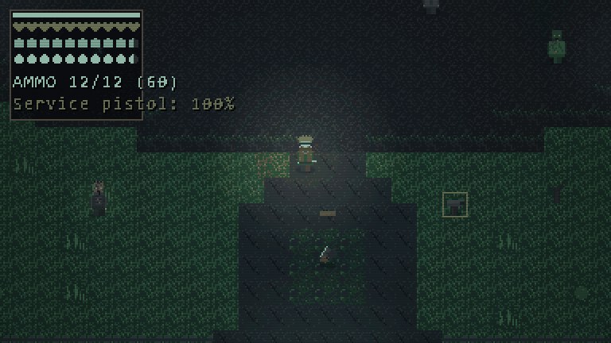
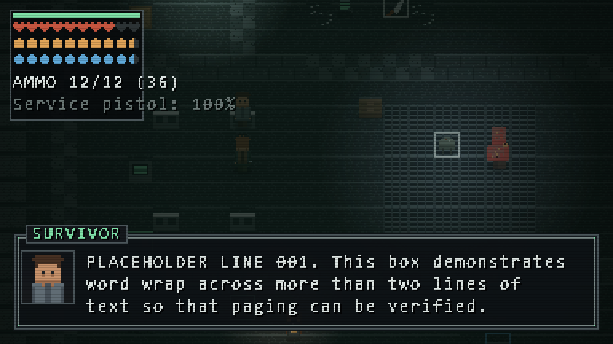
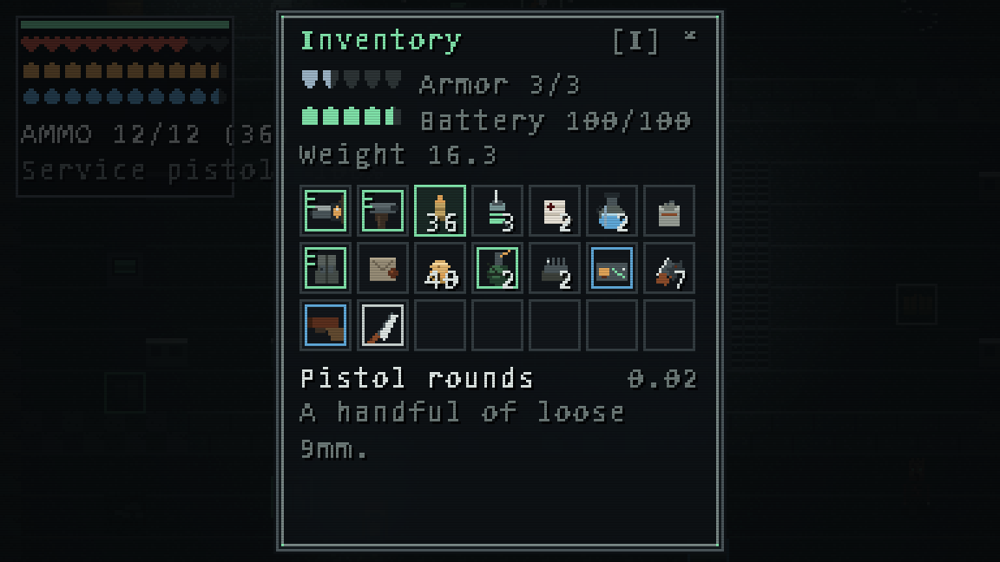
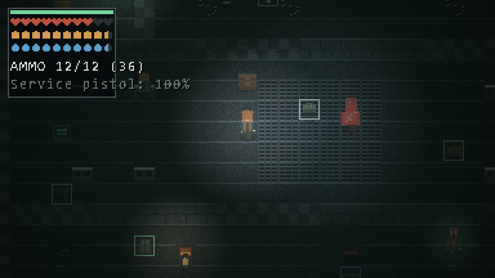
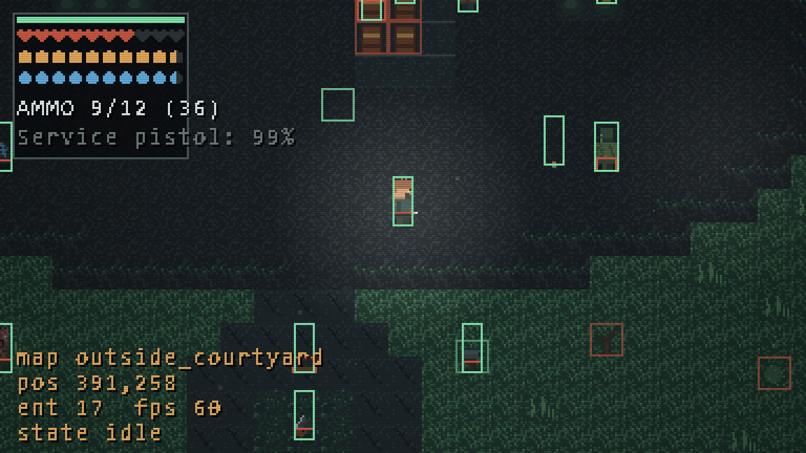
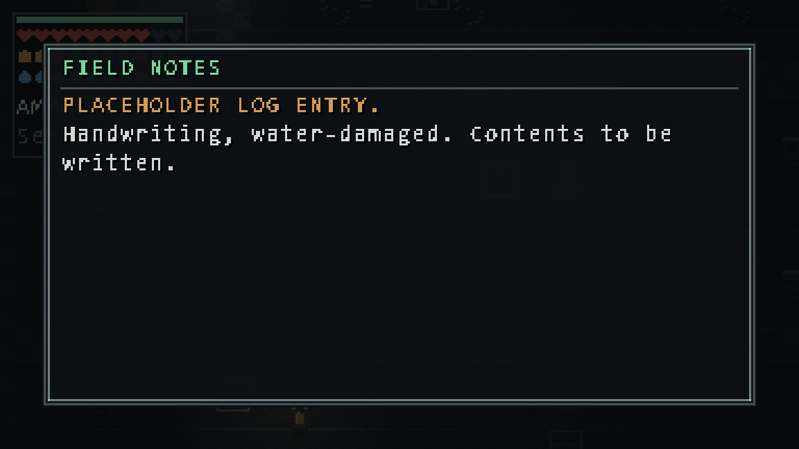
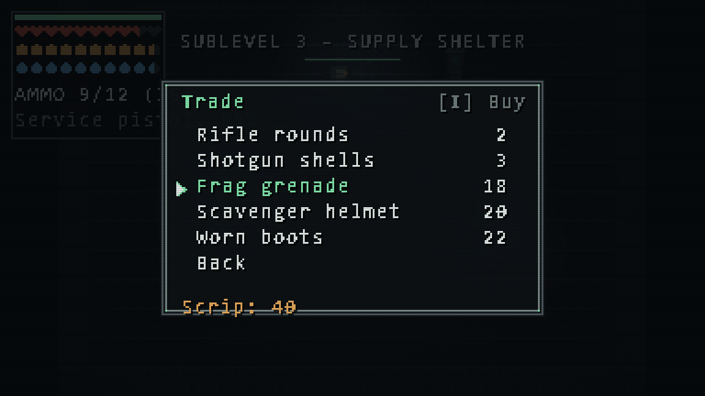
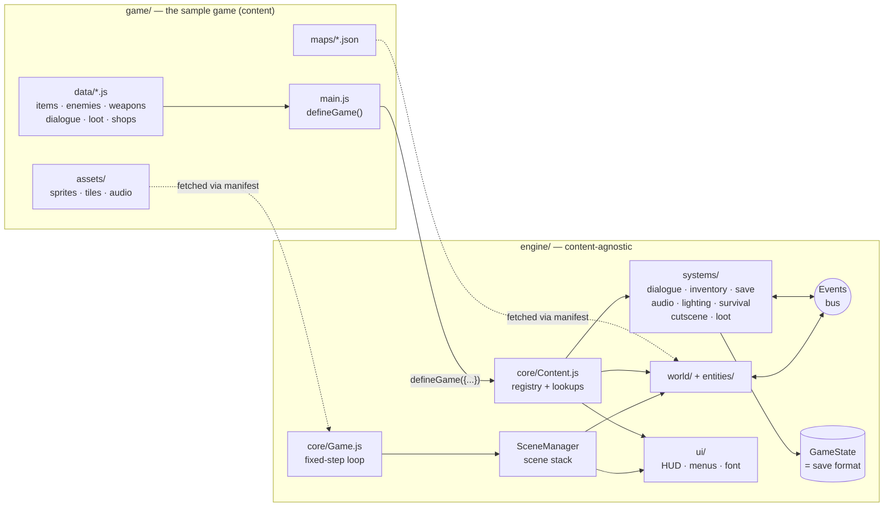

<div align="center">

# Vestige Engine

**A dependency-free engine for top-down pixel-art action RPGs, written in plain JavaScript.**

ES modules + Canvas 2D. No framework, no bundler, no `npm install`, nothing to build.<br>
It ships with **VESTIGE**, a playable survival-horror sample game built entirely on top of it.

[](https://github.com/eyboss202/Vestige-GameEngine/actions/workflows/ci.yml)
[](LICENSE)


[**▶ Play the demo**](https://eyboss202.github.io/Vestige-GameEngine/) &nbsp;·&nbsp;
[Quick start](#quick-start) &nbsp;·&nbsp;
[Make your own game](#make-your-own-game) &nbsp;·&nbsp;
[Architecture](#architecture) &nbsp;·&nbsp;
[Extending guide](docs/EXTENDING.md)



</div>

---

## Highlights

- **A real engine/game split.** Everything under `engine/` is content-agnostic; a game hands over its
  data once with `defineGame()` and never edits engine code. CI fails the build if the engine ever
  imports game code.
- **Zero dependencies, zero build.** ~7,000 lines of hand-written engine code that runs straight
  from the source files in any modern browser. `git clone` and serve the folder — that's the setup.
- **Data-driven everything.** Maps, items, weapons, enemies, loot tables, shops, dialogue trees and
  cutscenes are plain JSON/JS objects. New content is new data, not new code.
- **Pixel-perfect rendering.** The whole game draws into a 384×216 buffer and is upscaled with
  nearest-neighbour, so the pixel grid never breaks at any window size.
- **Deterministic simulation.** A fixed 60 Hz timestep with an accumulator — physics behaves the same
  on a 60 Hz laptop and a 240 Hz monitor.
- **Tested without a browser.** The engine's systems run headless in Node: 49 tests cover inventory,
  saves and migrations, dialogue, collision, loot, locks, localisation — plus a content lint that
  checks every cross-reference in the sample game.

## Table of contents

- [Quick start](#quick-start)
- [Feature tour](#feature-tour)
- [Make your own game](#make-your-own-game)
- [Architecture](#architecture)
- [Project structure](#project-structure)
- [Testing and CI](#testing-and-ci)
- [Asset pipeline](#asset-pipeline)
- [Roadmap](#roadmap)
- [License and credits](#license-and-credits)

---

## Quick start

ES modules & `fetch()` don't work from `file://`, so the folder has to be served over HTTP.
With Node 18+ (no packages are installed):

```bash
git clone https://github.com/eyboss202/Vestige-GameEngine.git
cd Vestige-GameEngine
npm start            # zero-dependency dev server on http://localhost:8080
```

Or with anything else that serves static files:

```bash
python3 -m http.server 8080
```

Then open <http://localhost:8080>. Sound starts after the first key press — browsers require a user
gesture before a page may play audio.

### Controls

| Action | Keys | | Action | Keys |
| --- | --- | --- | --- | --- |
| Move | Arrows / WASD | | Attack | J |
| Sprint | Shift | | Throw | K |
| Interact | E / Z / Enter | | Reload | R |
| Confirm | Z / Enter / Space | | Inventory | I / C |
| Cancel | X / Esc | | Drop (in inventory) | G |
| Pause | Esc / P | | Debug overlay | F1 |
| Fullscreen | F11 | | | |

Every action is rebindable in **Settings → Controls**, and the bindings persist.

---

## Feature tour

<table>
  <tr>
    <td width="50%"></td>
    <td width="50%"></td>
  </tr>
  <tr>
    <td><b>Dialogue</b> — branching trees driven by world flags, choices with requirements, portraits, and a typewriter with inline <code>[shake]</code> <code>[wave]</code> <code>[c=#hex]</code> tags.</td>
    <td><b>Inventory &amp; equipment</b> — stacking, categories, weight, rarity borders, durability, seven equipment slots feeding derived stats.</td>
  </tr>
  <tr>
    <td></td>
    <td></td>
  </tr>
  <tr>
    <td><b>Lighting</b> — per-map darkness with radial light cut-outs, coloured additive glow, flicker, vignette and a battery-powered flashlight indoors.</td>
    <td><b>Debug overlay (F1)</b> — collision grid, hitboxes, hurtboxes, entity count, FPS and the current AI state, live.</td>
  </tr>
  <tr>
    <td></td>
    <td></td>
  </tr>
  <tr>
    <td><b>Readables</b> — notes, logs and recordings reuse the dialogue machinery but render as a full book-styled page.</td>
    <td><b>Trading</b> — per-merchant stock and prices, buying and selling, built on an ordinary currency item.</td>
  </tr>
</table>

<details>
<summary><b>Full feature list</b></summary>

#### Core
- **Game loop** — fixed-timestep simulation (60 Hz) with uncapped rendering, frame-time clamping and
  spiral-of-death protection.
- **Scene stack** — menus push on top of the world and mark themselves transparent, so a paused game
  keeps rendering underneath. Fades between scenes are built in.
- **Event bus** — systems talk through `Events.emit('enemy:died')`, not references, so any of them can
  be replaced wholesale.
- **Renderer** — 384×216 off-screen buffer, integer or fill scaling, screen shake, flashes, vignette,
  scanlines.
- **Camera** — frame-rate-independent smoothing, map-bound clamping, shake, cutscene control.
- **Input** — an action layer (`Input.justPressed('attack')`) over fully rebindable keys.

#### World
- **Tile maps** from Tiled-shaped JSON: ground/decor/overhead layers, a collision grid, triggers,
  named spawn points, lights and per-map ambience.
- **Portals** between maps, optionally locked behind a world flag and/or a key item.
- **Triggers** — anything that isn't a portal is emitted as `trigger:<type>`; `reveal` (camera pan +
  line) and `ambush` (wake nearby enemies) ship as worked examples.
- **Y-sorted entities** anchored at their feet, with axis-separated collision that slides along walls.

#### Gameplay
- **Player** — acceleration/friction movement, sprint with stamina, footsteps, knockback, i-frames,
  and the equipped weapon drawn in hand.
- **Enemies** — an idle/patrol/chase/return/hurt state machine, a ranged variant that keeps its
  distance and fires, armor and per-damage-type resistances, positional voices and loot drops.
  Seven archetypes ship, each with distinct art and audio.
- **Combat** — melee hitboxes, pistols, rifles, shotguns (spread), thrown grenades and four trap types,
  all on one shared damage/targeting path. Magazines with manual reload and weapon durability.
- **Survival** — hunger, thirst and injuries (bleeding) with passive regeneration, tuned entirely from
  data. Segmented, animated HUD rows instead of bars.
- **NPCs** — wander, talk, trade, or follow a daily schedule driven by the in-game clock.
- **Containers, locks and keys** — one data-driven container class (drawers, lockers, chests…),
  partial looting, and locks shared by doors and containers.
- **Loot** — five rarity tiers and weighted drop tables.

#### Narrative
- **Dialogue trees** — flag branches, gated choices, flag writes and event emits from any node.
- **Cutscenes** — a step queue (`wait`, `moveTo`, `camera`, `cameraFollow`, `dialogue`, `flag`,
  `emit`, `fade`, `sfx`, `music`, `anim`) that pauses play the way a conversation does.

#### Persistence and settings
- **Saves** — three slots in `localStorage`, a versioned envelope with forward migrations, slot
  previews, and persistent world state: killed enemies, taken pickups, dropped items, looted
  containers, opened locks. Saving is done at in-world phones, by design.
- **Settings** — volumes, fullscreen, scaling, text speed, screen shake, FPS counter, language and key
  bindings, persisted the moment they change.
- **Localisation** — English and Portuguese for both UI and content; games can override or add
  strings without touching the engine.

#### Audio
- Web Audio graph with master/music/SFX buses, cross-faded music, positional (panned and attenuated)
  sound effects, and a chase stinger that takes over while something is hunting the player.

</details>

---

## Make your own game

A game is a folder with an entry module that calls `defineGame()`. This is the complete contract —
the sample game's [`game/main.js`](game/main.js) is the same thing with more content:

```js
import { defineGame, Game, BootScene, Cutscene } from '../engine/index.js';
import { MANIFEST } from './manifest.js';            // image/sound/music/map paths
import { ITEMS } from './data/items.js';

defineGame({
  baseUrl: new URL('./', import.meta.url),         // manifest paths resolve from here
  config: {
    id: 'my-game',                                  // namespaces saves and settings
    title: 'MY GAME',
    startMap: 'village',
    menuMusic: 'theme',
    currency: 'gold',
    player: { sprite: 'hero', stats: { maxHp: 30, hp: 30 } },
    onNewGame: (scene) => Cutscene.play([{ type: 'dialogue', id: 'opening' }]),
  },
  manifest: MANIFEST,
  items: ITEMS,
  weapons: { /* ... */ },
  enemies: { /* ... */ },
  dialogue: { /* ... */ },
  lootTables: { /* ... */ },
  shops: { /* ... */ },
  locales: { en: { 'menu.subtitle': 'a tiny adventure' } },
  palette: { glow: '#ffd166' },                     // re-theme the engine's UI
});

const game = new Game(document.getElementById('game'));
game.start(new BootScene(game));
```

Content stays declarative. An item is a plain object, and behaviour comes from small helpers:

```js
import { readable, placeTrap } from '../../engine/index.js';

export const ITEMS = {
  medkit: {
    id: 'medkit', icon: 0, category: 'consumable', stackSize: 5, consumable: true,
    name: { en: 'Medkit', pt: 'Kit medico' },
    onUse: ({ state }) => {
      if (state.player.hp >= state.derivedStat('maxHp')) return false;   // refuse: keep the item
      state.player.hp += 10;
      return true;
    },
  },
  old_letter: { id: 'old_letter', icon: 9, category: 'quest', onUse: readable('old_letter') },
  spike_kit:  { id: 'spike_kit', icon: 31, category: 'trap', consumable: true, onUse: placeTrap('spike', 7) },
};
```

New entity types plug into maps without touching the loader:

```js
import { Maps } from '../engine/index.js';
Maps.registerEntityType('chest', (def) => new Chest(def));   // now usable as { "type": "chest" } in map JSON
```

Every `config` key and its default is documented in [`engine/core/Content.js`](engine/core/Content.js),
and [`docs/EXTENDING.md`](docs/EXTENDING.md) has step-by-step recipes for maps, items, enemies,
weapons, dialogue, cutscenes, shops, traps, containers, languages, screens and save-format changes.

<details>
<summary><b>Asset keys the engine's built-in UI expects</b></summary>

The engine's menus, HUD and built-in entities draw from these manifest keys. A missing asset is
logged and skipped, never fatal — but supplying them is what makes the built-in UI look right.

| Kind | Keys |
| --- | --- |
| Images | `font_main` (7×12 ASCII bitmap font), `ui_panel` (9-slice), `ui_caret`, `ui_items` (16×16 icon strip), `hud_icons`, `portraits` (32×32 strip), `tileset` (16×16 tiles), `containers`, `phone` |
| Sounds | `ui_move`, `ui_select`, `ui_back`, `text_blip`, `pickup`, `hurt`, `footstep`, `door`, `attack_melee`, `attack_gun`, `throw`, `explosion`, `trap`, `reload`, `death_sting` |

Character sheets are 16×24 frames in a 4×4 grid: columns are the walk cycle, rows are the facings
**down, left, right, up**.

</details>

---

## Architecture



**One loop, many scenes.** `Game` owns the loop and hands each fixed tick to `SceneManager`, which
keeps a *stack* of scenes. Pausing pushes `PauseScene` over `GameScene` and marks it transparent, so
the frozen world keeps rendering underneath.

**One seam between engine and game.** `engine/core/Content.js` is the only place content enters the
engine. Engine modules ask it for `getItem(id)`, `getArchetype(id)`, `Content.dialogue[id]`… and never
import a data file. [`tools/check-imports.mjs`](tools/check-imports.mjs) enforces this in CI.

**Systems talk through events, not references.** A small pub/sub bus carries `inventory:changed`,
`enemy:died`, `dialogue:end`, `trigger:<type>`, `shop:open` and friends. A system can be swapped out
as long as it emits the same events — and a cutscene or quest step is just another listener.

**All mutable playthrough state lives in one object.** `GameState` holds the player, the current map,
world flags, inventory and equipment. `GameState.serialize()` *is* the save format, so persisting a new
system means adding one field — plus a migration case so old saves keep loading.

**Position convention.** An entity's `(x, y)` is its *feet* — bottom-centre of the sprite. Depth
sorting, shadows and collision all follow from that.

**Render order inside a map:** ground → decor → y-sorted entities → particles → overhead →
lighting → vignette → HUD → dialogue → debug.

---

## Project structure

```
Vestige-GameEngine/
├── index.html                 canvas + first-gesture hint; loads game/main.js
├── styles/main.css            page chrome only — all UI is drawn on the canvas
│
├── engine/                    THE ENGINE — never imports from game/
│   ├── index.js               public API: everything a game imports
│   ├── core/                  loop, renderer, camera, input, scenes, assets, events,
│   │                          state, collision, combat, locks, i18n, Content registry
│   ├── systems/               audio, save, dialogue, cutscene, inventory, survival,
│   │                          lighting, particles, notifications, loot, economy, item effects
│   ├── world/                 tile map + map loading / entity factory
│   ├── entities/              player, enemies, NPCs, pickups, props, containers,
│   │                          traps, projectiles, throwables, save phones
│   ├── ui/                    bitmap font, 9-slice, menu list, HUD, dialogue box,
│   │                          inventory, container and item-icon widgets
│   ├── scenes/                boot, title, settings, save slots, game, pause,
│   │                          inventory, container, shop, death
│   └── config/                engine constants, settings, keybindings, UI strings
│
├── game/                      VESTIGE — the sample game (pure content)
│   ├── main.js                defineGame({...}) + start
│   ├── manifest.js            every image, sound, track and map, by key
│   ├── data/                  items, weapons, enemies, dialogue, loot, rarity, shops, survival
│   ├── cutscenes/intro.js     fully commented cutscene template
│   ├── maps/                  three connected maps (Tiled-shaped JSON)
│   └── assets/                sprites, tiles, UI, fonts, audio
│
├── tests/                     node:test suites (engine + sample-game content lint)
├── tools/                     dev server, import checker, procedural asset generators
├── docs/                      EXTENDING.md recipes + README media
└── .github/workflows/         CI (Node 18/20/22) and GitHub Pages deploy
```

---

## Testing and CI

The engine only needs a browser to draw, play sound and read the keyboard — everything else runs
headless in Node, so it is tested directly with the built-in `node:test` runner:

```bash
npm test          # 49 tests
npm run check     # static import check + tests (what CI runs)
```

| Suite | Covers |
| --- | --- |
| `content.test.js` | `defineGame()` merging, lookups and fallbacks, storage namespacing, palette and base-URL handling |
| `inventory.test.js` | stacking, capacity and weight limits, use/refuse effects, equipment bonuses and the armor pool |
| `dialogue.test.js` | flag branches, gated choices, event emits, localisation, rich-text tag parsing |
| `save.test.js` | round-trips, per-game namespaces, kill persistence vs. older saves, migrations, corrupt slots |
| `systems.test.js` | weighted loot, shop pricing, wall-sliding collision, locale fallback chain, locks and keys |
| `sample-game.test.js` | every id the sample game references exists: items, weapons, ammo, loot, shops, dialogue nodes, portals, spawn points, manifest files |

GitHub Actions runs the import check and the tests on Node 18, 20 and 22 for every push and pull
request, and a second workflow publishes the playable demo to GitHub Pages.

---

## Asset pipeline

Every asset in the sample game is generated procedurally by scripts in `tools/` and named
`*_placeholder.*` — they exist so the project runs and looks coherent, and are meant to be replaced.

```bash
python3 tools/gen_art.py      # tileset, characters, enemies, portraits, UI, bitmap font  (needs Pillow)
python3 tools/gen_audio.py    # music and sound effects                                  (stdlib only)
python3 tools/gen_maps.py     # game/maps/*.json from readable ASCII layouts
```

`tools/creature-sfx/` holds the synthesiser behind the creature sounds and a browser player to
audition them. To replace an asset, drop in a file with the same dimensions and update its path in
`game/manifest.js` if the name changes — nothing else refers to asset paths.

---

## Roadmap

Seams are already reserved for these, so each is an addition rather than a rewrite:

- [ ] **Quest system** on top of world flags and dialogue/cutscene events (`GameState.quests` is reserved)
- [ ] **A\* pathfinding** over the collision grid (`Enemy.moveToward` is the single swap point)
- [ ] **Gamepad and touch input** folded into the existing action layer (`Input` is the only key reader)
- [ ] **Weapon mods** — every weapon already carries an unused `mods: []`
- [ ] **Reputation and factions** — `GameState.reputation` and `reputationDiscount()` are wired but neutral
- [ ] **Item repair** via the existing durability read/write API
- [ ] **Direct Tiled import** — the map JSON is already Tiled-shaped
- [ ] **Unicode bitmap font** — the placeholder atlas covers ASCII 32–126, so accents are folded today

---

## License and credits

Released under the [MIT License](LICENSE) © 2026 eyboss202.

All art, music and sound effects in the sample game were generated procedurally by the scripts in
[`tools/`](tools) — no third-party assets are included.
